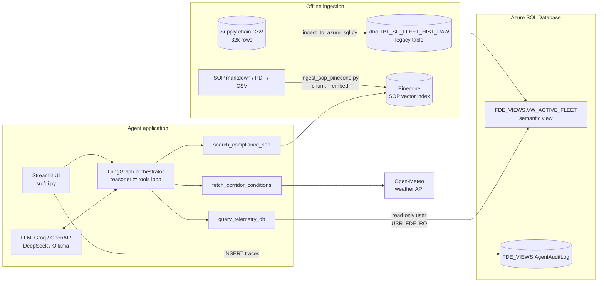

# Cold-Chain Logistics Copilot

An AI agent that lets a night-shift dispatcher ask plain-English questions about a refrigerated fleet, such as *"Which shipments near LA breach the SOP, and what do I do?"*, and get back an answer grounded in three sources:

1. **Fleet telemetry** from a legacy SQL database (temperature, location, risk, delay probability, port congestion)
2. **Live weather** for the vehicle's coordinates from a public REST API
3. **The company's Standard Operating Procedure (SOP)**, retrieved from a vector database

Every tool call and answer is written to an audit table that only an administrator can read.

The project follows the *Complete End To End AI Forward Deployed Engineer (FDE) Project Implementation* tutorial ([video](https://www.youtube.com/watch?v=FSZhPDzESPU)). Several decisions differ from the tutorial; they are explained in [Design decisions](#design-decisions) below.

> Setup and run instructions are in **[SETUP.md](SETUP.md)**.

---

## The scenario

A Southern California logistics company has:

- **A legacy fleet database.** Column names like `IOT_TEMP_VAL_C`, `PRT_CNG_LVL` and `RISK_CLS_TXT` were designed for machines, not people. Nobody is allowed to change this table.
- **An SOP document** ([policy/Cold_Chain_Incident_SOP_v2.md](policy/Cold_Chain_Incident_SOP_v2.md)) defining the rules: the allowed temperature range, when to divert away from a congested port, and when to escalate to a manager.
- **Dispatchers** who must apply those rules quickly, at night, across many shipments.

The goal is a copilot that reads the data, applies the SOP rules row by row, and says exactly what to do and why, without making up rules the SOP doesn't contain.

## What "Forward Deployed Engineer" means here

A Forward Deployed Engineer works inside the customer's environment rather than a clean greenfield one. That shaped most of the decisions in this repo:

- **The customer's systems are fixed.** We adapt to the legacy schema instead of redesigning it.
- **Security is enforced by the infrastructure, not by trust in the model.** The agent runs with a database user that can only read one view.
- **The customer's policy is the source of truth.** The agent must cite the SOP, and must say "the SOP does not define this" instead of falling back on general industry knowledge.
- **Every action is traceable.** Each tool call and answer is logged so a human can audit what the AI did.
- **Swappable vendors.** The LLM and embedding provider are chosen through configuration, because each customer has different cost, privacy and procurement constraints.

---

## Architecture



### Components

| Layer | File | What it does |
|---|---|---|
| Legacy data load | [data-ingestion/scripts/ingest_to_azure_sql.py](data-ingestion/scripts/ingest_to_azure_sql.py) | Loads 9 of the CSV's 26 columns, renames them to cryptic legacy names, and writes them to `dbo.TBL_SC_FLEET_HIST_RAW`. This simulates the customer's existing system. |
| Semantic layer and security | [data-ingestion/scripts/setup_security_and_view.sql](data-ingestion/scripts/setup_security_and_view.sql) | Creates a view with human-readable column names, plus a read-only database user that can query only that view. |
| SOP knowledge base | [data-ingestion/scripts/ingest_sop_pinecone.py](data-ingestion/scripts/ingest_sop_pinecone.py) | Splits the policy files into chunks, embeds them, and upserts them to Pinecone. Unchanged files are skipped and deleted files are removed from the index. |
| Agent tools | [src/agent_tools.py](src/agent_tools.py) | The three tools the LLM can call: a SQL query, a weather lookup, and an SOP search. |
| Orchestrator | [src/orchestrator.py](src/orchestrator.py) | A LangGraph state machine. The reasoner node calls the LLM, the tools node runs any tool calls, and the loop repeats until the LLM gives a final answer. Also has a terminal chat mode. |
| System prompt | [src/prompts/system_prompt.txt](src/prompts/system_prompt.txt) | The role, grounding rules, SOP checks to apply per row, and output format. |
| UI and audit | [src/ui.py](src/ui.py) | Streamlit dispatch console that shows each tool call and its raw output, plus an admin-only audit log viewer. |

### How a question flows

1. The dispatcher asks a question in the UI.
2. The reasoner sends the system prompt, the conversation and the tool definitions to the LLM.
3. The LLM requests tool calls. For example, it writes a T-SQL `SELECT` against the view and asks for the SOP rules on temperature.
4. The tools node runs them. The SQL runs as `USR_FDE_RO`, and results are capped at 10 rows.
5. The tool results go back to the reasoner. The loop continues until the LLM answers without asking for another tool.
6. Every tool input, tool output and final answer is written to `FDE_VIEWS.AgentAuditLog`.

---

## Design decisions

### 1. Simulate a legacy schema rather than load clean data
The CSV has readable column names. The loader renames them to `IOT_TEMP_VAL_C`, `CGO_COND_CD` and so on on purpose. Real customer data looks like this, and the project should show how to work with it rather than assume it away.

### 2. A semantic view between the LLM and the raw table
The LLM never sees `dbo.TBL_SC_FLEET_HIST_RAW`. It queries `FDE_VIEWS.VW_ACTIVE_FLEET`, where columns are named `Current_Temperature_C`, `Delay_Probability` and so on. This:
- makes the LLM write correct SQL far more often, because readable names leave less room for misreading or inventing columns;
- gives us a stable contract: if the legacy table changes, we update the view and the agent keeps working;
- keeps out columns the agent doesn't need.

### 3. Database permissions are the real safety boundary
[src/agent_tools.py](src/agent_tools.py) rejects any query that doesn't start with `SELECT`. That check is a convenience, not a security control, because it is easy to get around. The real control is the database user:
- `USR_FDE_RO` has `SELECT` on the view only;
- `SELECT` on the raw table is explicitly denied;
- `INSERT`, `UPDATE`, `DELETE` and `ALTER` on the `dbo` schema are denied.

Even if the model is tricked by prompt injection, the database refuses anything outside that scope.

**Different from the tutorial:** the tutorial uses `CREATE LOGIN` against `master` on a local Docker SQL Server. Azure SQL Database doesn't allow that outside `master`, so we use a **contained database user** (`CREATE USER ... WITH PASSWORD`) that exists only inside the app database. Connections are encrypted (`Encrypt=yes`), because Azure requires it.

### 4. SOP retrieval through a vector database, chunked by headings
- Markdown files are first split on `#`, `##` and `###` headings, then into chunks of about 600 characters. Each SOP section stays together with its heading as metadata, so a rule never gets cut away from its threshold.
- The ingestion is incremental. An MD5 hash per file is cached, unchanged files are skipped, and deleted files are removed from Pinecone. Chunk IDs are fixed (`<file>-chunk-<n>`), so re-running never creates duplicates.
- PDF, TXT, CSV and XLSX are supported as well, because customer policies rarely all come in one format.
- The retriever returns `k=4` chunks. With `k=2`, the port-congestion rule was never retrieved and the agent missed it, so we raised it.

### 5. Embeddings: local by default, one index per model
`Embeddings_model=LOCAL` uses `BAAI/bge-m3` (1024 dimensions) on CPU, with no API cost and no data leaving the machine. `OPENAI` uses OpenAI embeddings (1536 dimensions). Each model writes to its own Pinecone index (`fde-sop-index-local` / `fde-sop-index-openai`), because vectors from different models can't be compared. If an index has the wrong dimension, the ingestion script deletes and recreates it.

### 6. The LLM is chosen by configuration
`Agent_llm` selects `OPENAI`, `DEEPSEEK`, `GROQ` or a local Ollama model. DeepSeek and Groq both offer OpenAI-compatible APIs, so they reuse `ChatOpenAI` with a different `base_url` and need no extra packages. We moved from DeepSeek to **Groq's free tier** (`openai/gpt-oss-120b`) after the DeepSeek account ran out of credit, which needed no code changes beyond the new branch.

### 7. An explicit LangGraph graph instead of a pre-built agent
A two-node graph (`reasoner` ⇄ `tools`) makes every step visible: the UI streams each tool call and its raw output as it happens, and the audit log records them. `MemorySaver` keeps conversation memory per `thread_id`, so each UI session has its own history.

### 8. Grounding is enforced in the prompt, and the prompt is enforced in the graph
An early version of the agent, asked about "Tier 1 vs Tier 2 escalation", produced a detailed table of response times, delay thresholds and cargo codes. **None of it was in the SOP**, and it told dispatchers that a 5°C reading was a "minor" issue when the SOP calls anything above 4.0°C a critical breach.

Two fixes:
- **The system prompt requires grounding.** Every rule must come from the SOP search and be cited; quotes must match the SOP word for word; gaps must be stated as "The SOP does not define this." The prompt also lists the three SOP checks to apply to every telemetry row.
- **The prompt is added inside the reasoner node** on every LLM call. Before this, only the terminal mode loaded the prompt, so every answer in the UI ran with no instructions.

After the fix, the same question gets: *"The SOP does not define Tier 1 escalation"*, followed by a quote of the one real escalation rule.

### 9. Audit logging to the database
Each tool input, tool output and final answer is written to `FDE_VIEWS.AgentAuditLog`, tagged with the session ID. The agent user can only insert into it. Reading the log in the UI needs the admin credentials. If logging fails, the error is printed to the terminal and the dispatcher's session continues.

---

## Repository layout

```
.
├── data-ingestion/
│   ├── data/raw/dynamic_supply_chain_logistics_dataset.csv   # source data (32,065 rows, 2021–2024)
│   ├── scripts/
│   │   ├── ingest_to_azure_sql.py        # CSV → legacy SQL table
│   │   ├── setup_security_and_view.sql   # semantic view + read-only user
│   │   └── ingest_sop_pinecone.py        # SOP → Pinecone
│   ├── db-ingestion-instructions.md
│   └── .env.example
├── policy/Cold_Chain_Incident_SOP_v2.md  # the SOP the agent must follow
├── data/cache/ingestion_hash_cache.json  # incremental-ingestion state
├── src/
│   ├── agent_tools.py
│   ├── orchestrator.py
│   ├── prompts/system_prompt.txt
│   └── ui.py
├── requirements.txt
├── README.md
└── SETUP.md
```

---

## Known limitations and next steps

- **The data is historical, not live.** Despite its name, `VW_ACTIVE_FLEET` reads a 2021–2024 history table. A real deployment would point the view at a live feed, or filter it to the latest reading per vehicle.
- **The SOP's "ETA delay greater than 1 hour" rule can't be evaluated.** The CSV has `eta_variation_hours`, but the loader doesn't ingest it. Adding it to the legacy table and the view would let the agent apply the diversion rule.
- **There is no cargo type.** The agent has to assume fresh perishables (0–4°C), so readings of –10°C may simply be frozen cargo.
- **The weather risk index is a placeholder.** It is 8.5 if wind is above 10 km/h and 2.5 otherwise. It is labelled as weather, not congestion, so the model doesn't confuse it with port congestion.
- **Conversation memory is in-process.** `MemorySaver` is lost on restart; a production version would use a persistent checkpointer.
- **Some SQL isn't in the repo yet.** `setup_security_and_view.sql` has the agent user's password hardcoded (it should come from a secret store), and the audit-table DDL lives only in [SETUP.md](SETUP.md).
- **There is no automated evaluation.** A small set of questions with expected SOP findings, run against each prompt or model change, would catch regressions like the invented Tier 1 table.
